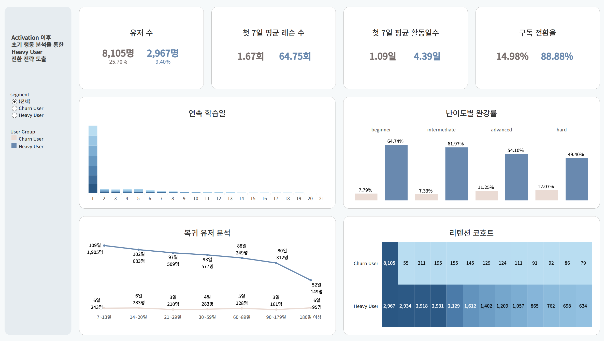

# 교육 플랫폼 초기 행동 분석을 통한 Heavy User 전환 전략 도출

**Education Platform Activation & Retention Analysis**

## 1. 프로젝트 개요

교육 플랫폼의 가입자 중 실제 학습을 시작하는 사용자의 비율을 파악하고, Activation 이후 초기 행동 패턴을 분석하여 Heavy User 전환 및 Retention 개선 전략을 도출한 프로젝트입니다.

전체 가입자 대비 활성화 사용자 비율이 낮다는 문제에서 출발하여, 활성화 이후에도 지속적으로 학습하는 사용자와 이탈하는 사용자의 행동 차이를 비교했습니다.

특히 **첫 7일간의 학습 행동**에 주목하여 학습 빈도, 활동일 수, 콘텐츠 탐색, 질문 기능 사용 등 주요 지표를 분석하고, 이를 바탕으로 신규 사용자의 학습 지속을 유도하는 A/B 테스트를 기획했습니다.

### 프로젝트 핵심 결과

| 지표 | 분석 결과 |
|---|---|
| 전체 가입자 | 144,957명 |
| Activated User | 31,525명 (21.75%) |
| Heavy User | 2,967명 (활성 사용자 중 9.41%) |
| Early Churn User | 8,105명 (활성 사용자 중 25.71%) |
| Heavy User 7일 평균 학습 수 | 64.75개 |
| Early Churn User 7일 평균 학습 수 | 1.67개 |

## 2. 문제 정의

교육 플랫폼에서 회원가입은 실제 서비스 이용이나 지속적인 학습으로 이어진다는 것을 보장하지 않습니다.

따라서 다음 세 가지 질문을 중심으로 분석을 진행했습니다.

1. 전체 가입자 중 실제 학습을 시작한 사용자는 얼마나 되는가?
2. 지속적으로 학습하는 사용자와 조기에 이탈하는 사용자는 어떤 행동 차이를 보이는가?
3. 초기 행동 분석 결과를 활용하여 Retention을 개선하려면 어떤 실험을 설계해야 하는가?

## 3. 분석 방법

### 3.1 Activation 분석

사용자가 최소 1개의 레슨을 완료한 경우를 Activation으로 정의하고, 가입자 대비 활성화 비율을 분석했습니다.

- 전체 가입자: 144,957명
- Activated User: 31,525명
- Activation Rate: 21.75%

### 3.2 사용자 세그먼트 분석

Activation 이후 학습 지속 행동에 따라 사용자를 Heavy, Normal, Early Churn 그룹으로 분류했습니다.

| 세그먼트 | 사용자 수 | 활성 사용자 내 비중 |
|---|---:|---:|
| Heavy | 2,967 | 9.41% |
| Normal | 20,453 | 64.88% |
| Early Churn | 8,105 | 25.71% |

### 3.3 초기 7일 행동 비교

Heavy User와 Early Churn User의 초기 학습 행동을 비교했습니다.

| 지표 | Heavy | Early Churn |
|---|---:|---:|
| 7일 평균 레슨 수 | 64.75 | 1.67 |
| 7일 평균 활동일 수 | 4.39일 | 1.09일 |
| 질문 기능 사용률 | 약 96% | 약 23% |
| 구독 전환율 | 88.88% | 14.98% |

학습을 지속하는 사용자는 초기부터 더 높은 학습 빈도와 활동일 수를 보였으며, 질문 기능과 다양한 학습 콘텐츠를 적극적으로 이용하는 경향이 관찰됐습니다.

다만 이러한 결과는 사용자 그룹 간의 **관찰된 연관성**으로, 특정 행동이 Heavy User 전환을 직접 유발한다는 인과관계를 입증하지는 않습니다.

## 4. 핵심 인사이트

**Insight 1. Activation 이후에도 조기 이탈 사용자가 상당수 존재**

전체 활성 사용자 중 약 25.7%가 Early Churn 그룹으로 분류되었습니다. 따라서 최초 학습 완료뿐 아니라 이후 학습 지속 여부를 함께 관리할 필요가 있습니다.

**Insight 2. 초기 학습 빈도와 활동일 수에서 뚜렷한 차이 관찰**

Heavy User는 초기 7일 동안 평균 64.75개의 레슨을 학습한 반면, Early Churn User는 평균 1.67개에 그쳤습니다.

**Insight 3. 질문 기능 및 콘텐츠 탐색 행동에서도 차이 발견**

Heavy User는 질문 기능을 더 적극적으로 이용하고 다양한 학습 카테고리를 탐색하는 경향을 보였습니다.

이러한 분석 결과를 바탕으로 신규 사용자가 첫 학습 이후 다음 학습으로 자연스럽게 이어질 수 있는 온보딩 개선 전략을 제안했습니다.

## 5. 개선 전략 및 A/B 테스트 기획

### D0 Micro-Lesson Onboarding

신규 가입자의 초기 학습 부담을 줄이고 학습 지속을 유도하기 위해 짧은 마이크로 레슨을 연결하는 온보딩 실험을 기획했습니다.

| 구분 | Control (A) | Treatment (B) |
|---|---|---|
| 온보딩 방식 | 기존 자율 탐색 방식 | 마이크로 레슨 자동 연결 |
| 학습 경험 | 사용자가 직접 콘텐츠 선택 | 약 3분 길이의 레슨 3~5개 제공 |
| 목적 | 기존 학습 경험 유지 | 초기 학습 지속 유도 |

**Primary KPI**

- D7 Range Retention: 가입 후 D1~D7 중 레슨을 1개 이상 완료한 사용자 비율

**실험 목표**

- 기존 D7 Range Retention: 51.5%
- 목표 D7 Range Retention: 56.5%
- 목표 개선폭: +5%p
- 최소 표본 크기: 그룹당 약 1,601명 (기획안 기준)

**예상 효과 (가정 기반 추정)**

- 월간 추가 Retained User 약 389명
- 추가 구독 전환 약 32명
- 월 매출 증가 약 160만 원

※ 본 A/B 테스트는 실험 설계 및 기대 효과 추정 단계이며, 실제 실험을 통한 개선 효과는 검증되지 않았습니다.

## 6. 데이터 시각화

Tableau를 활용하여 사용자 세그먼트별 학습 행동과 Retention 지표를 비교할 수 있는 대시보드를 제작했습니다.

주요 시각화 항목:

- Heavy / Early Churn 핵심 KPI 비교
- 연속 학습일 분포
- 난이도별 완강률
- 복귀 사용자 분석
- Retention Cohort 분석



## 7. 기술 스택

| 구분 | 기술 |
|---|---|
| 데이터 처리 및 분석 | Python, Pandas |
| 데이터 시각화 | Tableau |
| 분석 방법 | Funnel Analysis, Cohort Analysis, Retention Analysis, User Segmentation |
| 실험 기획 | A/B Testing, KPI Definition, Sample Size Planning |
| 협업 및 버전 관리 | Git, GitHub |

## 8. 프로젝트 구조

```text
education-platform-retention-analysis/
├── notebooks/
│   ├── 260515ver_...ipynb
│   └── Activation_...ipynb
├── dashboard/
│   ├── Activation 이후 초기 행동 분석을 통한 Heavy User 전환 전략 도출.png
│   └── Activation 이후 초기 행동 분석을 통한 Heavy User 전환 전략 도출.twbx
├── reports/
│   ├── 분석 보고서.docx
│   ├── 요약 보고서.docx
│   ├── 요약 보고서.pdf
│   ├── 원페이퍼.pdf
│   ├── A_B Test 기획안.docx
│   └── A_B Test 기획안.pdf
└── README.md
```

※ 위 트리는 가독성을 위해 일부 실제 파일명을 축약했습니다.

## 9. 분석의 한계 및 향후 개선 방향

- Heavy User와 Early Churn User의 행동 차이는 관찰 분석 결과이므로 인과관계로 단정할 수 없습니다.
- 사용자 세그먼트의 분류 기준과 관찰 기간을 고려하여 결과를 해석해야 합니다.
- 마이크로 레슨 온보딩의 효과는 실제 A/B 테스트를 통해 검증해야 합니다.
- 서로 다른 Retention 지표의 정의와 분석 대상이 혼동되지 않도록 지표 정의를 명확하게 문서화할 필요가 있습니다.

## 10. 프로젝트 산출물

- Jupyter Notebook: Activation 및 초기 행동 분석 코드
- Tableau Dashboard: 사용자 세그먼트별 행동 시각화
- Analysis Report: 분석 과정 및 결과 보고서
- One-Pager: 프로젝트 핵심 결과 요약
- A/B Test Plan: D7 Retention 개선 실험 기획안
